# Nandwright: Nand2Tetris IDE for VS Code

Nandwright is a VS Code extension for doing the whole [Nand2Tetris](https://www.nand2tetris.org/)
course ("Nand to Tetris", *The Elements of Computing Systems*) inside the editor. It runs
your HDL chips in a hardware simulator and draws them as live circuit diagrams, runs every
`.tst` test script, assembles and runs Hack assembly on a CPU emulator, runs VM code and
Jack programs on a VM emulator with the Hack screen and keyboard, and shows you why a test
failed. It needs no Java and no `tools` folder: the simulators are built into the extension.

It is for students whose course uses the classic project folders (`projects/01` …
`projects/12`) and who would rather stay in VS Code than switch between the editor and the
official Java programs. Results are checked against those Java programs.

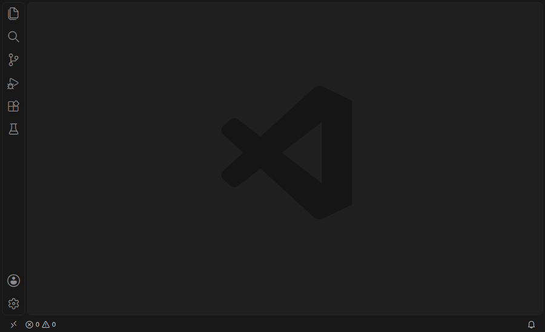

> Unofficial. Nandwright is not affiliated with or endorsed by the authors of Nand to
> Tetris. It contains no course material and no solutions.

## Install

In VS Code open the Extensions view, search for **Nandwright** and press **Install**. Or
install it from its
[Marketplace page](https://marketplace.visualstudio.com/items?itemName=nandwright.nandwright).
VS Code keeps it up to date from then on.

That is all. It works on Windows, macOS and Linux with VS Code 1.91 or newer.

**Without the Marketplace** (VSCodium, an offline machine): download
`nandwright-<version>.vsix` from the
[Releases](https://github.com/ToTt0G/nandwright/releases) page, then in the Extensions view
choose **…** and **Install from VSIX…**. It is the same file on every platform. A copy
installed this way does not update itself.

## Quick start

1. **Open your course folder**: the one that contains `projects`. Nothing needs to be configured.
2. **Open a chip**, for example `projects/01/Not.hdl`, and write its `PARTS:` section.
   Completion offers chips and their pins; mistakes are underlined as you type.
3. **Press the play button** at the top right of the editor (or `Ctrl+Alt+T`, `Cmd+Alt+T` on a Mac).
   The chip's test script runs and the result appears: passed, or the first line that
   differs from the compare file.
4. **If it fails**, the failing row shows expected against actual, which columns differ,
   and the value of every pin, internal ones included, at that step.

No course folder at hand? Run **Nand2Tetris: Get Started** from the Command Palette and
choose "Try the example chip": a small practice chip (not a course project) to write and test.
The [`examples`](examples) folder of this repository has more: chips, assembly programs and a Jack program.

## What you can do

### Run and test

- **Every `.tst` script is a test** in VS Code's Testing view: run one, a folder, or the
  whole course. Hardware Simulator, CPU Emulator and VM Emulator scripts all work; the
  extension reads from the script which kind it is.
- **Test directly from your source file** (`.hdl`, `.asm`, `.hack`, `.vm`, or `.jack`):
  press the play button (`Ctrl+Alt+T`, `Cmd+Alt+T` on a Mac) or click **Run test** above
  the code. When a test script loads a `.hack` or `.vm` file (such as project 4's
  `Mult.tst` and `FillAutomatic.tst`, or project 12's `load,` OS tests), Nandwright
  assembles your `.asm` or compiles your `.jack` in memory whenever the built file is
  missing, older than the source, or being edited — without writing `.hack` or `.vm` files
  to disk (controlled by `nandwright.test.buildSources`). Forever demonstration scripts
  such as `Fill.tst` are skipped in favour of the automated script (`FillAutomatic.tst`).
- The `.out` file is written next to the script, as the official tools do.
- Scripts that wait for a key (project 5's `Memory.tst`) get the key pressed for them, and
  the output says so.
- Tests run when you save a file, quietly, in the Testing view.
- Above a chip or program, beside Run test, the editor shows whether its test passes or
  how many rows differ.
- The status bar shows how many of the folder's tests pass; click it for the list of what is passing, failing, not run or not started.

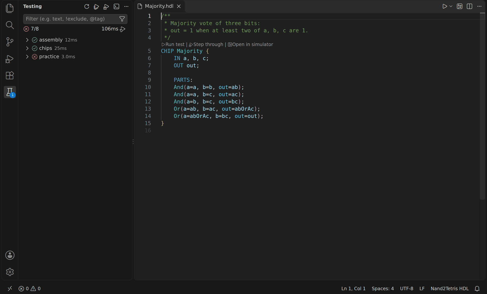

### See why a test failed

- The failing row with **expected and actual**, the **columns that differ**, and **every pin
  at that step**, shown at the script line that produced it. All failing rows are listed,
  not only the first.
- **Step through the test script** with the debugger: breakpoints in the `.tst` file, Step
  Over to the next `;`, pins in the Variables view.
- **Compare Output with Expected** diffs `.out` against `.cmp` side by side.

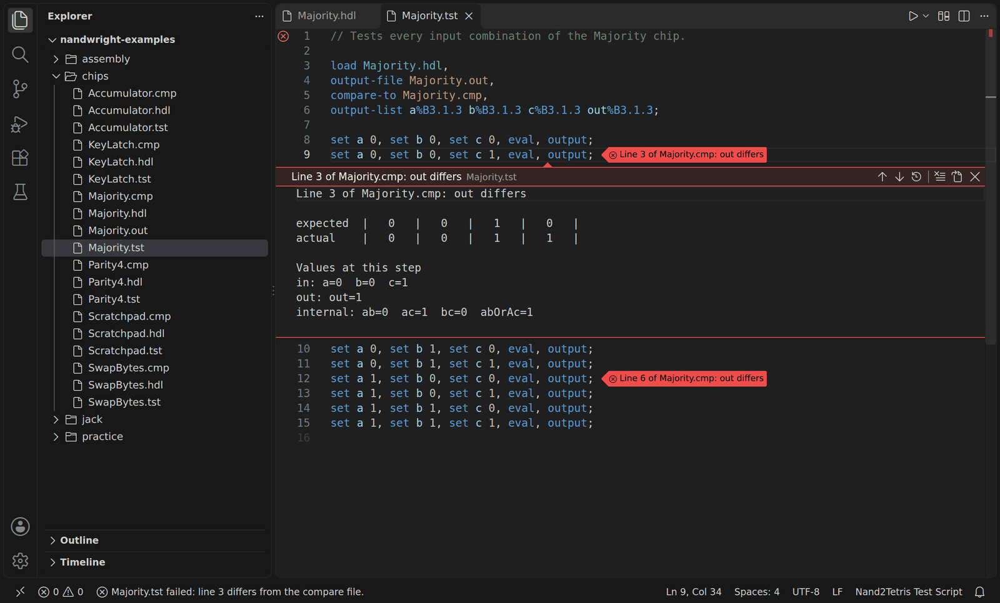

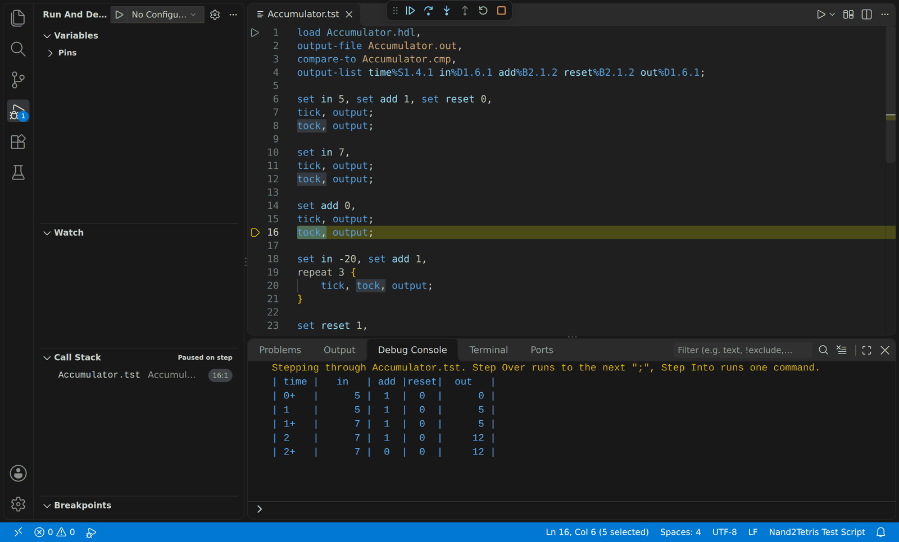

### Try a chip by hand

- **Open in simulator** shows a chip next to its code: flip inputs, type bus values in
  decimal, binary or hex, and watch outputs and internal pins. Small chips get a full
  truth table.
- Clocked chips have **Tick**, **Tock** and the clock time, so you can watch a register load.
- For clocked chips the simulator keeps a clock history: the pins after each tick and tock.
- The panel follows the editor as you type. It follows you from chip to chip as you switch files. Below the pins it shows the expected output from the chip's `.cmp` file, and marks where your chip disagrees.
- The chip simulator marks each row of the expected output as matching, differing or not reached after a test run, and has a Run test button.

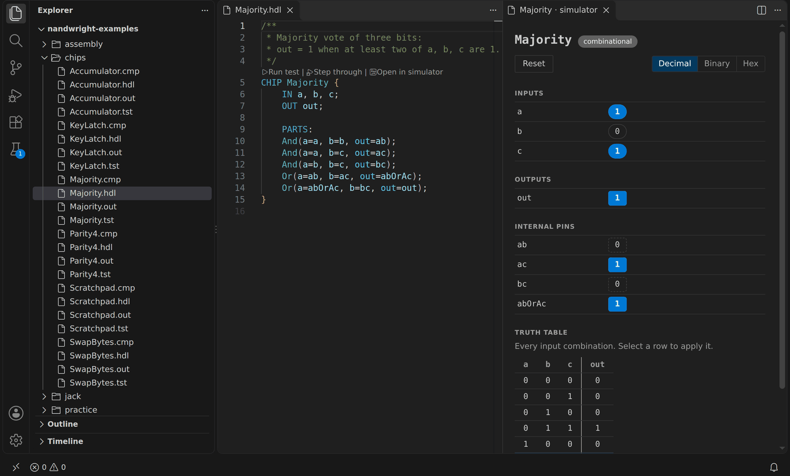

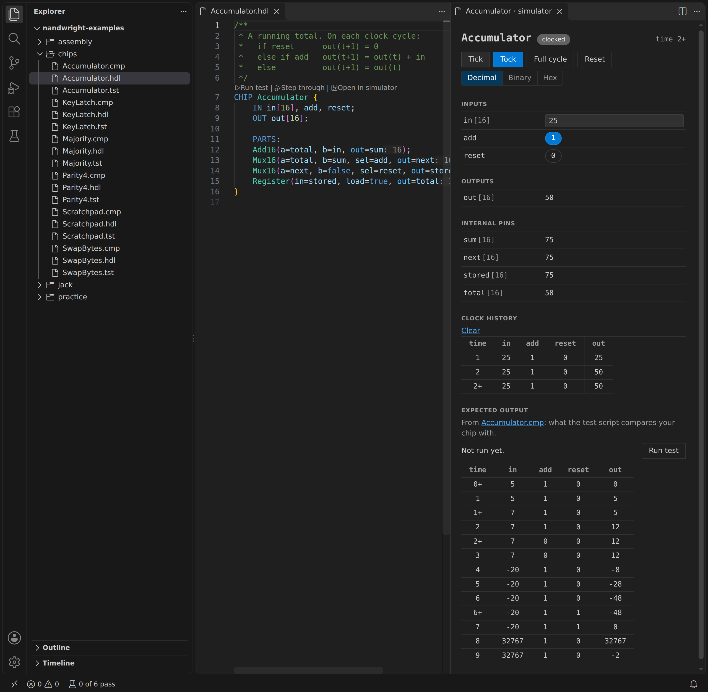

### See the circuit

- **Show Circuit Diagram** draws a chip as a live schematic next to its code: inputs on the
  left, outputs on the right, gates as gate shapes, other chips as boxes. A wire is bright
  when it is 1; buses show decimal, binary or hex, and hovering a wire or part shows its
  value and pins.
- Click an input to flip it or type a value, or use **Tick**, **Tock** and **Step** on a
  clocked chip. Wires light up in the order the signal travels through the chip.
- Double-click one of your own chips to step inside it with live values driven from above.
  The path at the top takes you back up.
- Click a part or a wire to find it in the HDL; put the cursor on a part statement and the
  diagram marks it. The diagram updates as you edit and follows you between `.hdl` files.
- If the chip simulator shows the same chip, the two share one simulation: flip an input or
  advance the clock in either and both change.
- Pan, zoom and **Fit** to inspect larger chips, or **Export…** the current view as SVG or PNG.

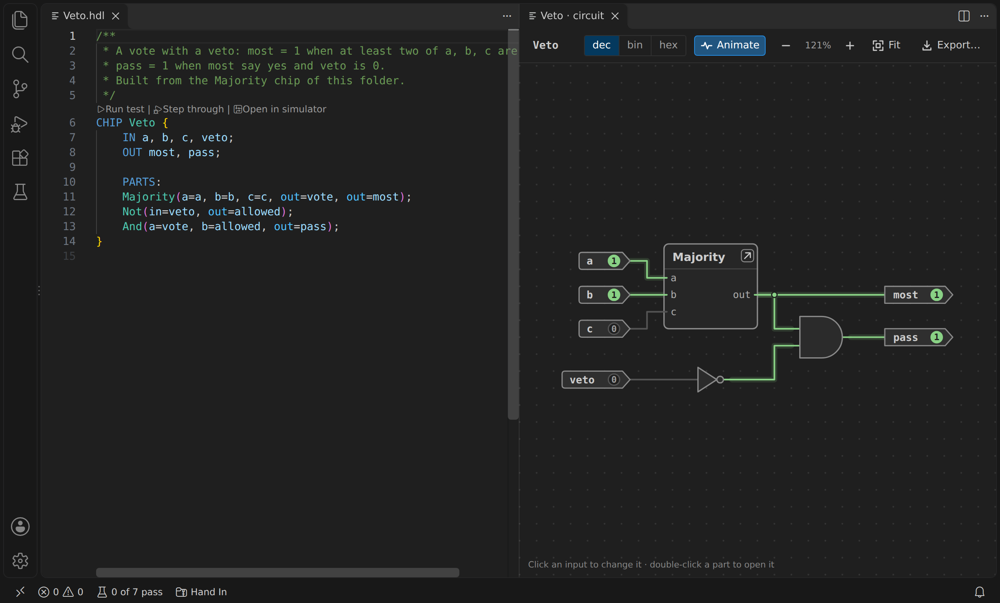

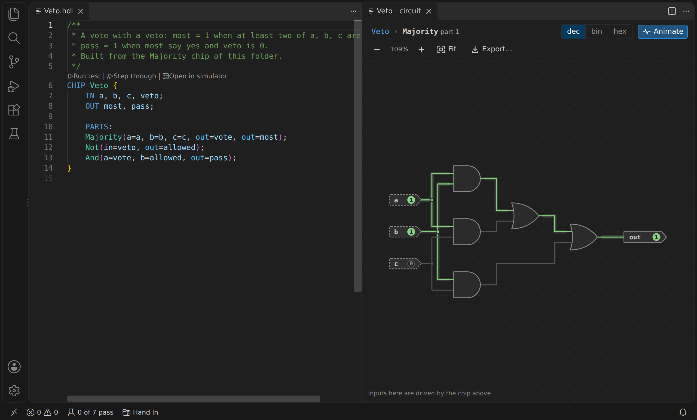

### Run programs: assembly, VM code, Jack

- **Run Program** runs a `.asm` or `.hack` file on the Hack computer, and a `.vm` file or a
  Jack program on the VM emulator, with the **screen**, the **keyboard**, registers, the
  stack, the call stack and memory. Run, pause, step, choose the speed.
- Switch to another `.asm`, `.hack`, `.vm` or `.jack` tab to load it in the same panel. The
  previous program stops and the new program starts paused. Turn off
  `nandwright.simulator.followEditor` to keep individual panels fixed to their files.
- Saving an `.asm` file reloads it in the Hack computer while the machine is still at reset.
- Below the screen, the panel shows the **Expected output** table from the program's
  `.cmp` file, marks each row as matching, differing (with what your program gave) or not
  reached after a test run, and includes **Run test**, **Inspect failure**, and **Diff `.out` ↔ `.cmp`**
  buttons (plus a script picker when several `.tst` scripts test the same program). Click
  **Inspect failure** or any reached row to jump the live Hack computer or VM emulator —
  registers, RAM, stack, call stack, screen and source highlight — straight to that test row,
  with differing registers and RAM cells highlighted in place. Visual OS tests that ship a
  reference image (such as `ScreenTestOutput.gif` or `OutputTestOutput.gif`) show an
  **Expected screen** preview beside the live screen.
- **Breakpoints** set in the editor pause the program; the line about to run is highlighted.
  Jack programs step by Jack line.
- Jack runs with a built-in OS (`Math`, `String`, `Array`, `Output`, `Screen`, `Keyboard`,
  `Memory`, `Sys`). Classes you write yourself, including OS classes for project 12,
  replace the built-in ones. As in the official VM Emulator, the built-in `Sys.init` first
  runs your own `Memory.init`, `Math.init`, `Screen.init`, `Output.init` and `Keyboard.init`,
  and the built-in `Array.new`, `String.new` and their `dispose` use your own `Memory.alloc`
  and `Memory.deAlloc`.

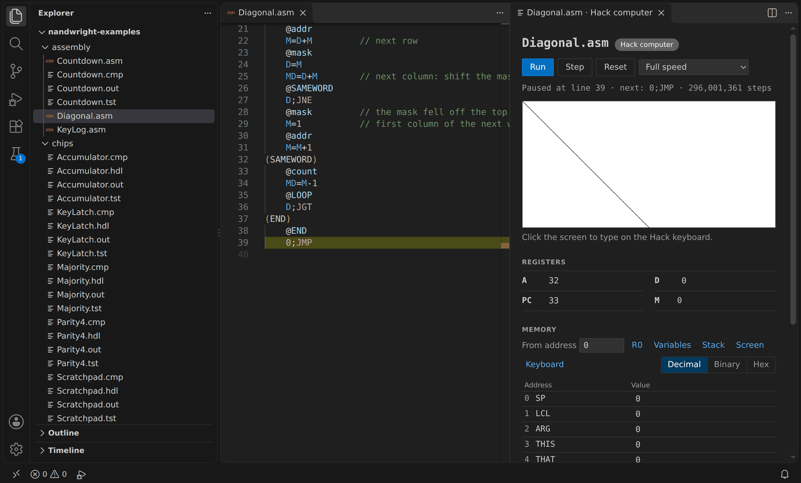

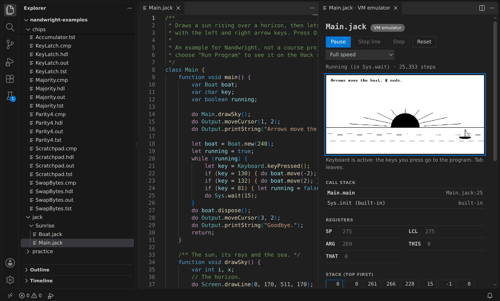

### Check your own assembler, translator and compiler

In projects 6 to 11 you write the tools yourself. Nandwright does not overwrite their output,
and when your own tool writes a newer `.hack` or `.vm` file, running the test script tests
your file as-is.

- **Compare with Reference Output** on a `.hack`, `.vm` or `.xml` file your tool wrote
  (also offered as **Compare with reference** at the top of the file) shows
  a diff against what the built-in assembler, compiler or syntax analyzer produces. As with
  the official TextComparer, spaces and tabs inside a line do not count, so XML without
  indentation matches. The reference is what the official tools write; a course's own
  expected files can use other label names.
- Your VM translator's `.asm` output runs under the course's CPU Emulator test scripts in
  the Testing view.
- **Assemble to .hack File** and **Compile Jack to VM Files** write the official output when
  you ask, and ask before replacing a file whose content differs.
- **Zip Project for Hand-In** packs a project for handing in. See [Handing in](#handing-in).

### Write code

- HDL: completion, hover, go to definition (also into the built-in chips), find references,
  rename, signature help in part lists, quick fixes for misspelled chips and pins,
  semantic highlighting.
- Hack assembly: hover shows the machine code and address of an instruction; go to
  definition, references and rename for labels and variables.
- Jack: errors as the official compiler reports them (checked across the classes of a
  folder), hover with types and VM segments, completion including the OS API, rename.
- Test scripts and VM files: highlighting and diagnostics; `.out` files show which cells
  differ from the `.cmp` file.
- **Format Document** for HDL and test scripts changes whitespace only: indentation, spacing
  and runs of blank lines. It never joins two lines or splits one, and it checks its own
  output before touching your file.
- A chip or subroutine that is not written yet is not an error.

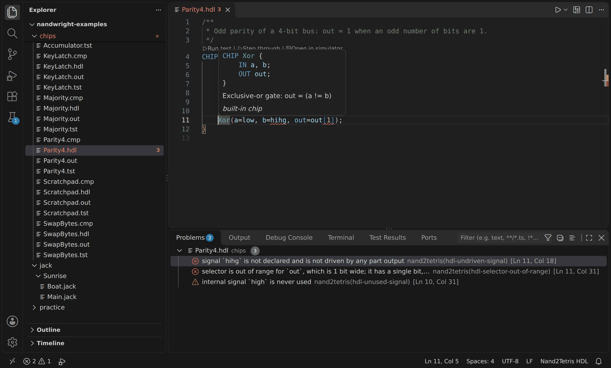

The panels use your colour theme, including light and high-contrast themes.

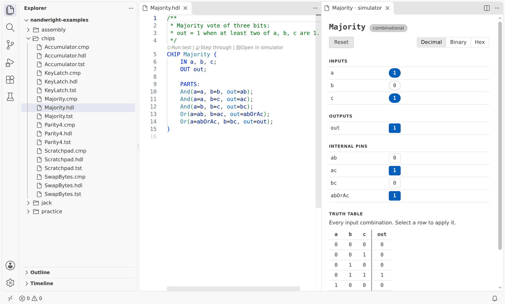

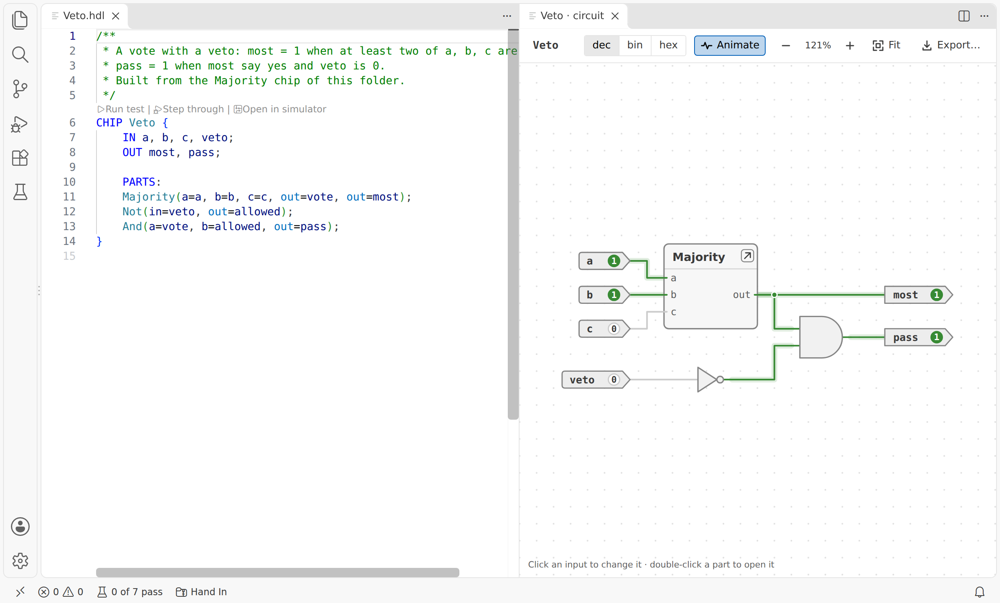

## Handing in

**Zip Project for Hand-In** makes the zip you hand in. Start it from **Hand In** in the
status bar, from the editor's `…` menu, from the project progress list, or by
right-clicking a folder in the Explorer. When the last failing test of a folder passes,
Nandwright also offers to zip it.

The list shows every file of the project. Your own work is ticked. Test scripts, compare
files and generated files are not (a VM translator's `.asm` next to its `.vm` files counts
as generated). You choose the final list. The `+` button adds a file from anywhere.

The easiest way to set it up is **Nand2Tetris: Set Up…** in the Command Palette. It asks
for your course, your name and your grade sheets. You can skip any step.

- **The zip's name.** The setting `nandwright.zip.fileName` is the name without `.zip`.
  `{folder}` is the folder's name, `{n}` the project's number and `{nn}` that number with
  two digits. `{familyname}` and `{firstname}` are your name from
  `nandwright.student.familyName` and `nandwright.student.firstName`, which are kept in your
  user settings only. If the name needs one of them and it is not set, you are asked when
  you zip. Example: `Project{nn}-{familyname}-{firstname}` gives
  `Project01-familyname-firstname.zip` for a folder named `01`.
- **Projects made of several folders, or numbered differently.** The setting
  `nandwright.zip.projects` lists the folders of each project, by the course's numbers.
  With `{ "1": ["01", "02"], "2": ["03"] }`, zipping `01` or `02` packs both folders into
  one zip, with their files side by side. `{n}` is then `1`. Zipping `03`, or a folder
  inside it such as `03/a`, is project `2`. If two folders hold a file of the same name,
  each copy goes under its folder's name. A listed folder that does not exist is named in
  the list.
- **The grade sheet.** If your course has one sheet per project, keep the sheets in a
  folder named `grade-sheets` in your workspace. **Set Up** can copy the sheets you
  downloaded there; it never replaces a sheet without asking. The zip takes the sheet
  named like `Project1.xlsx` or `project_01.ods` for the project's number. It looks in
  the project's folder, then the folder in `nandwright.zip.gradeSheetFolder`, then a
  `grade-sheets` folder (in the workspace or beside the project), then the folder above
  the project and the workspace. The sheet is ticked and shows when it last changed. Its
  button opens it, so you can fill it in first; the zip takes the sheet as it is saved
  when you save the zip.

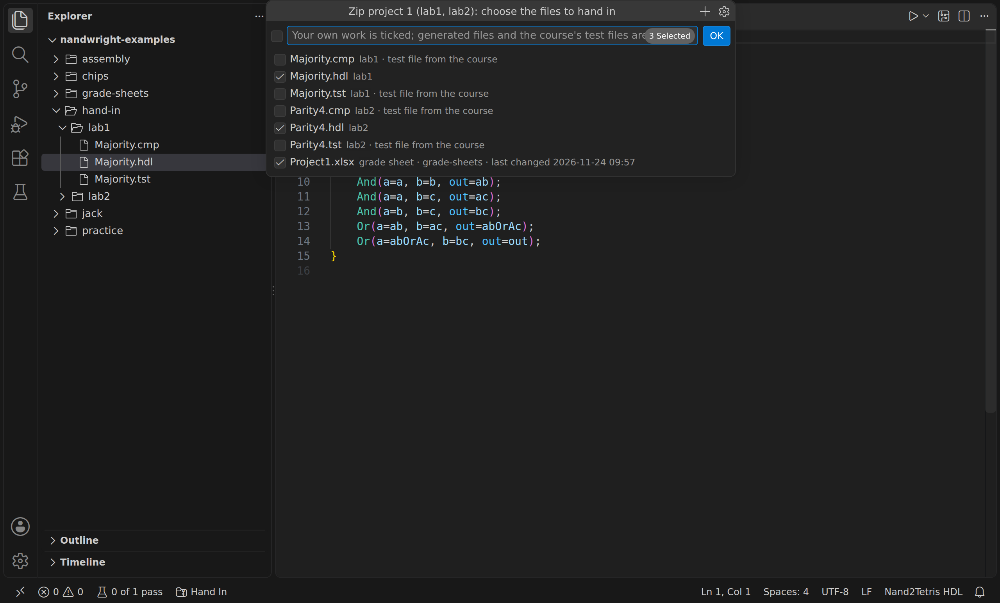

## Course presets

A course preset sets the hand-in rules of one course at once. Choose it with
**Nand2Tetris: Set Up…** or the setting `nandwright.course`. The default is no preset:
nothing course-specific is on. A setting you set yourself wins over the preset.

- **KTH EP121U** (Computer Science): projects 1 to 4 are the book's folders `01` and `02`
  (together), `03`, `04` and `05`. Projects 5 to 10 are the course's own folders. Zips are
  named `Project01-familyname-firstname.zip`, and `project09-familyname-firstname.zip` for
  project 9. Only the files the course asks for are ticked: the `.hdl` files, the `.asm`
  files, or the named Python and Jack files. The project's grade sheet is added.

Presets for other courses are welcome as contributions: see `extension/src/presets.ts`.

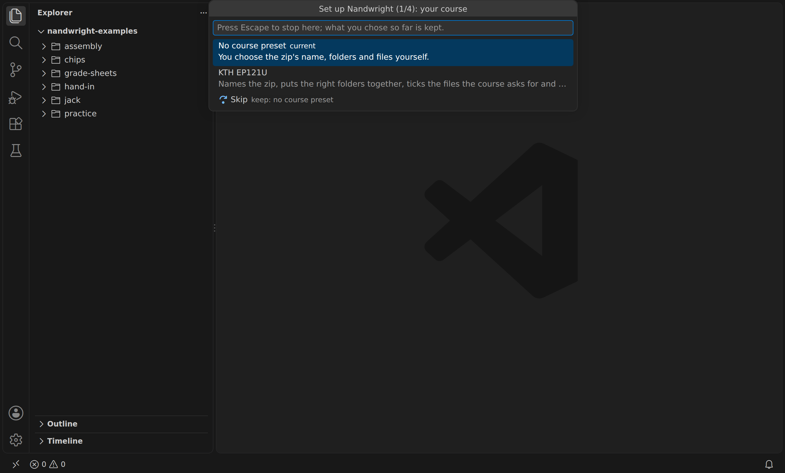

## Course projects

| Project | You write | What Nandwright does for it |
|---|---|---|
| 1 Boolean logic, 2 Arithmetic, 3 Memory, 5 Computer | Chips in HDL | Simulates them, runs the test scripts, shows failing rows with internal pins, interactive simulator with clock, live circuit diagrams with drill-down |
| 4 Machine language | Hack assembly | Runs CPU Emulator test scripts directly from `.asm` (even when the script loads `.hack`) without writing `.hack` files; shows expected `.cmp` output and pass/fail marks in the Hack computer panel; runs programs with screen and keyboard; assembles to `.hack` |
| 6 Assembler | An assembler | Compares your `.hack` with the reference; runs it on the Hack computer |
| 7, 8 VM translator | A VM-to-Hack translator | Runs the course's CPU Emulator scripts on your `.asm`; runs the `…VME.tst` scripts and any `.vm` program on the VM emulator |
| 9 High-level language | Jack programs | Compiles and runs them with the built-in OS; breakpoints and stepping by Jack line |
| 10 Syntax analyzer | A tokenizer and parser | Compares your `.xml` with the reference token list and parse tree |
| 11 Compiler | A Jack compiler | Compares your `.vm` with the reference; runs your `.vm` on the VM emulator |
| 12 Operating system | The OS classes in Jack | Runs the project's test scripts directly from `.jack` in memory without writing `.vm` files; shows expected `.cmp` output and reference screen images in the VM emulator; runs test programs with your classes in place of the built-in ones |

## Does it match the official tools?

That is the point of the project, so it is measured. A conformance harness runs the same
inputs through the official Java tools and through Nandwright's engine and compares the
outcome, the failing line and the bytes of the output file. On the classic course
distribution:

- **Test scripts**: 301 cases (every hardware test of projects 1, 2, 3 and 5 on solved
  chips and on the untouched skeletons, 23 hand-written broken cases, 180 generated broken
  chips, the CPU Emulator tests of project 4 and the VM Emulator tests of projects 7, 8 and
  12). 299 give the same result as Java. The other two differ on purpose.
- **Assembler and CPU emulator**: identical `.hack` files, and identical registers and
  memory after every instruction, over the course's programs and generated ones.
- **Jack compiler**: byte-identical `.vm` output on every Jack file of the course and on
  generated programs, and the same accept-or-reject decision with the error on the same line.
- **VM emulator and built-in OS**: memory and all 8,192 screen words compared with Java on
  the course's test programs and on probes of each OS function.

Every deliberate difference is listed, with the reason, in [docs/DEVIATIONS.md](docs/DEVIATIONS.md).
The exact numbers and how to reproduce them are in [docs/VERIFICATION.md](docs/VERIFICATION.md).

## How it compares

| | Needs Java and the `tools` folder | Runs tests in the editor | Failing row with internal pins | Live circuit diagrams | CPU and VM emulators with screen | Works on plain course folders |
|---|---|---|---|---|---|---|
| **Nandwright** | No | Yes | Yes | Yes | Yes | Yes |
| Official Java tools | Yes (they are the tools) | Separate windows | Compare by eye | No | Yes | Yes |
| [Official web IDE](https://nand2tetris.github.io/web-ide) | No | In the browser | Diff of the output table | No | Yes | It keeps its own copy of the projects |
| VS Code extensions that launch the Java tools (for example Nand2Tetris Tools, NAND IDE, Mastro NANDo) | Yes | Result in a terminal | No | No | In the Java windows | Yes |
| VS Code extensions for highlighting and snippets | Not applicable | No | No | No | No | Yes |

The official tools and the official web IDE are the reference; if your course tells you to
use one of them for grading, do that for your final check. The descriptions of other
extensions are from their own Marketplace pages at the time of writing.

## Questions

### How do I run a Nand2Tetris .tst file in VS Code?

Install Nandwright, open the `.tst` file (or the `.hdl`, `.asm`, `.hack`, `.vm`, or `.jack`
file it tests) and press the play button at the top right of the editor, or run it from the
Testing view. No setup is needed.

### Do I need Java?

No. Nandwright does not use the official Java programs. Its simulators, assembler,
emulators and Jack compiler are compiled to WebAssembly and shipped inside the extension.

### Does it work with the course's project folders?

Yes. Open the folder you unzipped from the course (the one with `projects` in it). The
untouched course files open without errors: an unwritten chip is shown as a hint, not a problem.

### Will my chip get the same result as in the official Hardware Simulator?

It has on every case measured so far: see "Does it match the official tools?". If you find
a case where it does not, that is a bug; please open an issue with the chip's interface and
the test (not your solution).

### How do I see the internal pins of an HDL chip?

Four ways: a failing test lists them for each failing row; **Open in simulator** shows them
live as you change inputs; **Show Circuit Diagram** draws every internal wire and lets you
double-click your own chips to look inside them; **Step through** shows them in the
debugger's Variables view.

### How do I run a Hack assembly or Jack program and see the screen?

Open the `.asm`, `.hack`, `.vm` or `.jack` file and choose **Run Program** from the play
button's menu. Click the screen to send keys to the Hack keyboard.

### I am writing my own assembler, VM translator or compiler. How do I check it?

Open the file your tool produced (`Prog.hack`, `Main.vm`, `MainT.xml`, `Main.xml`) and run
**Nand2Tetris: Compare with Reference Output**. For the VM translator, run the course's
test scripts on the `.asm` your translator wrote.

### Why does the output say a key was pressed for me?

Some official scripts wait until you hold a key down in the simulator window. Nandwright
presses the key the script is waiting for so that the test can finish. Turn off the setting
**Nandwright › Test: Press Keys** to do it yourself.

### Does it work in the browser (vscode.dev) or with the web IDE's files?

It needs desktop VS Code. It is tested with the classic course distribution; the newer
project files use the same languages, but they have not been run through the conformance
harness.

### Does it include solutions to the projects?

No, and it will not. The repository's tests use chips and programs that are not course
assignments, and a check in CI enforces that.

## The command line

The engine also builds as a native command, `n2t`, used by the test suite:

```sh
cargo build --release -p n2t-cli
n2t test projects/01            # run every test script in a folder (strict Java behavior)
n2t test --build projects/04    # assemble .asm / compile .jack in memory when .hack/.vm is missing
n2t check projects              # report problems in .hdl, .tst, .asm, .vm and .jack files
n2t eval Majority.hdl a=1 c=1   # evaluate a chip and print every pin
n2t fmt --check projects/01     # check formatting
```

## Building and testing

You need Rust (with the `wasm32-unknown-unknown` target) and Node 20 or newer.

```sh
cargo test --workspace                 # the engine
cd extension && npm ci
npm run build:wasm && npm run build    # the extension
npm run test:unit                      # the engine through its WebAssembly loader
xvfb-run -a npm run test:integration   # the extension in a real VS Code (plain `npm run …` on Windows and macOS)
npm run package                        # dist/nandwright-<version>.vsix
```

On Windows, run them from a short path such as `C:\src\nandwright`: the copy of VS Code that the tests download lives inside the checkout, and it stops working when its path grows beyond 260 characters.

[docs/ARCHITECTURE.md](docs/ARCHITECTURE.md) explains how the pieces fit;
[conformance/README.md](conformance/README.md) explains how to run the comparison with the
Java tools (you need your own copy of the course files; they are not in this repository).

## License and credits

Nandwright is licensed under the [Mozilla Public License 2.0](LICENSE).

It builds on [isXander/nand2tetris](https://github.com/isXander/nand2tetris) (MPL-2.0),
whose HDL and test-script front-ends, hardware simulator and language server are the
starting point of the engine, and uses the Hack font table from the official
[web IDE](https://github.com/nand2tetris/web-ide) (MIT). [NOTICE.md](NOTICE.md) has the details.

Nand to Tetris and *The Elements of Computing Systems* are the work of Noam Nisan and
Shimon Schocken. This project is independent of them.
